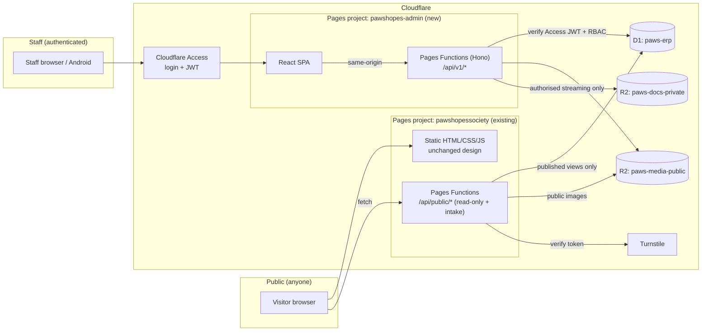

# ARCHITECTURE.md — Paws Hopes Society ERP

| | |
|---|---|
| Version | 0.1 |
| Status | PROPOSAL — awaiting approval |
| Date | 14 Nov 2026 |

---

## 1. Goals and constraints

- **Preserve the public website.** Keep its design, URLs and SEO.
- **Give staff a private ERP** that they can run from a phone, with no code edits for routine work.
- **Near-zero running cost.** Stay on Cloudflare's free tiers for the pilot and about US$5/month in production.
- **No unnecessary paid third parties.**
- **Financial and medical records must be tamper-evident and history-preserving.**
- **The team is small and non-technical**, so operational simplicity beats cleverness.

---

## 2. High-level architecture



### Key properties

- **Two deployments, one database.** The public site and the admin ERP are separate Pages projects. Each calls **its own same-origin API**, so there is no CORS. The admin's Access cookie never reaches the public site.
- **The public API is narrow by construction.** It contains only:
  - read queries against `published` content;
  - insert-only intake endpoints (rescue reports, volunteer sign-ups, adoption applications), each protected by Turnstile and rate limits.
- **The admin is protected twice:**
  1. Cloudflare Access at the edge.
  2. Access JWT verification plus a role-based permission check inside every API handler.
- **Two R2 buckets.**
  - The public media bucket holds animal photos and CMS images, as resized web copies.
  - The private bucket holds medical files, invoices, IDs and agreements. **It has no public URL.** Files are streamed only by the admin API, after an authorisation check.

This works with or without a custom domain. With one, the layout is `www.example.org` and `admin.example.org`; without one, it is `pawshopessociety.pages.dev` and `pawshopes-admin.pages.dev`. **A custom domain is recommended** (ADR-6).

---

## 3. Technology choices

| Layer | Choice | Why | Alternatives considered |
|---|---|---|---|
| Admin UI | React + TypeScript + Vite + Tailwind + shadcn/ui | As requested; shadcn copies components into the repo rather than adding a runtime dependency | — |
| Routing and forms | React Router, React Hook Form, Zod | As requested; Zod schemas are **shared** with the backend | — |
| Server state | TanStack Query | Caching and invalidation for list/detail screens on flaky mobile networks | Hand-rolled fetch (more bugs) |
| Charts | Recharts | Dashboard only | Chart.js |
| API | Hono on Pages Functions | Small, Workers-native, typed middleware for auth/RBAC/validation | Plain Functions handlers (more boilerplate) |
| DB access | Drizzle ORM (D1 driver) | Typed queries; schema in TypeScript | Raw SQL (kept for triggers/views) |
| Migrations | SQL files applied with `wrangler d1 migrations apply` | Native, versioned, reviewable in PRs; triggers need hand-written SQL anyway | drizzle-kit push (unsafe for prod) |
| Auth | Cloudflare Access (one-time PIN by email and/or Google login) + `jose` for JWT verification | Free for ≤50 users; no passwords to store | Self-built auth (high risk) |
| PDFs (receipts, reports) | Generated **in the browser** (pdf-lib) | Keeps Worker CPU within limits and costs zero | Worker-side rendering (CPU-heavy) |
| Image resizing | **Client-side** (canvas) before upload | Free; reduces R2 storage | Cloudflare Images (paid) |
| Tests | Vitest + `@cloudflare/vitest-pool-workers` (real D1 in workerd); Playwright for E2E | Tests run in the actual runtime | Mocked DB (misses SQL bugs) |
| Monorepo | npm workspaces | No extra tooling | pnpm/turbo (not needed at this size) |

All packages must be re-verified for Workers compatibility and pinned to exact versions at the start of Phase 3. **No dependency is added without a line in DECISIONS.md.**

---

## 4. Repository layout

**Problem.** The existing Pages project probably publishes the **repo root** (REPOSITORY_AUDIT T8). If so, adding ERP folders would make source, migrations and docs publicly downloadable.

**Proposal.** Restructure as below. `git mv` preserves file history. The change is tested on a preview branch before the production output directory is changed.

```
pawshopessociety/
├── apps/
│   ├── public/                 ← existing site, files unchanged, moved here
│   │   ├── index.html … contact.html
│   │   ├── assets/
│   │   ├── _headers            ← new: security headers
│   │   └── functions/api/public/   ← new: Pages Functions (public API)
│   └── admin/                  ← new: React SPA
│       ├── src/
│       └── functions/api/v1/   ← Hono API
├── packages/
│   ├── shared/                 ← Zod schemas, permission constants, types
│   └── db/                     ← Drizzle schema, query helpers
├── migrations/                 ← 0001_init.sql, 0002_… (ordered, immutable once applied)
├── scripts/                    ← animals.js migration, backup/restore scripts
├── docs/                       ← these documents
└── .github/workflows/          ← CI: typecheck, test, gitleaks, migration dry-run
```

**Repository visibility.** The repo is currently public. Public is acceptable only if no secrets are ever committed, which CI enforces with gitleaks. Even so, **a private repo is recommended** once ERP code lands. Pages builds private repos on the free plan.

---

## 5. Environments

| | Development | Staging | Production |
|---|---|---|---|
| Where | Local `wrangler pages dev` | Pages **preview** deployments of the `staging` branch | Pages production (`main`) |
| D1 | Local SQLite (Miniflare) | `paws-erp-staging` | `paws-erp-prod` |
| R2 | Local | `paws-*-staging` | `paws-*-prod` |
| Access | Bypassed by a **dev-only** stub user (impossible to enable in prod builds) | Access app on preview domain | Access app on production domain |
| Data | Synthetic seed data | Synthetic + migrated animals.js | Real |

Pages supports separate bindings for Preview and Production, so staging can never touch production data.

**Branches:**

- Feature branches → PR → `staging`.
- `staging` → PR → `main`, which requires your explicit approval.

---

## 6. Authentication and authorisation flow

1. A staff member opens the admin URL. Access shows a login page (email one-time PIN or Google).
2. The Access policy allowlists specific email addresses. This list is mirrored from the `users` table by the Super Admin.
3. Every request carries the `Cf-Access-Jwt-Assertion` header. Middleware then:
   - verifies the signature against the team's public certs, plus the `aud`, `iss` and `exp` claims;
   - looks up the user by email and **rejects the request unless the user is `active`**;
   - loads their roles and permissions (cached per request).
4. Each route declares its required permission, for example `expense.approve`. Service-layer rules add the checks a permission string can't express:
   - **separation of duties**: approver ≠ submitter;
   - **row scoping**: volunteers see only their own tasks.
5. Mutating requests also require:
   - a JSON content type;
   - a same-origin `Origin` header;
   - an `Idempotency-Key` on financial POSTs.

**Deactivation works at two layers:** removing the user from the Access policy blocks them at the edge, and setting `users.status = inactive` blocks them in the API immediately.

**Volunteer portal (future).** Access is free for up to 50 users. Beyond that, *every* seat is billed (§10). If volunteer numbers grow, the volunteer portal should get its own lightweight login instead (ADR-5).

---

## 7. Data and file design (summary; see DATABASE_SCHEMA.md)

### 7.1 Data rules

- **Money** is stored as integer **paise**. Never floats.
- **Timestamps** are ISO-8601 UTC strings. They are displayed in IST.
- **Ledger, receipts, stock movements and audit log are append-only.** SQLite triggers abort any `UPDATE`/`DELETE`. Corrections are made by **reversal entries**.

### 7.2 D1 transaction model

D1 has no interactive `BEGIN…COMMIT` from Workers. Atomic multi-step writes therefore use `db.batch([...])`, which runs as one transaction. Invariants rely on unique constraints and conditional `INSERT … SELECT … WHERE` statements, rather than a read-then-write pattern in application code. Gapless receipt numbering uses a `sequences` row incremented inside the same batch that inserts the receipt.

### 7.3 Files

- **Upload flow:** browser resize → `POST /api/v1/uploads` (validated) → R2 → `documents` row → linked to an entity.
- **Public images** get a resized web copy with **EXIF/GPS data stripped**. The original stays in the private bucket.

---

## 8. Public website integration (Phase 6)

**Progressive enhancement:**

- Existing pages keep their HTML.
- `script.js` fetches `/api/public/animals`, `/api/public/stats` and `/api/public/content/{key}`.
- If a fetch fails, the page falls back to the current bundled data until cut-over is signed off.

**SEO fix.** A Pages Function middleware on `/adopt` and `/rescue` uses HTMLRewriter to inject the published cards into the HTML on the server. Crawlers see the real content; the page looks identical.

**Caching.** Public GET responses carry `Cache-Control: public, max-age=60, stale-while-revalidate=600`. Publishing in the CMS purges the cache for the affected keys. The result is fast pages and very few D1 reads.

**Forms.** Forms move to native HTML posting to `/api/public/forms/{rescue|volunteer|adoption|contact}`, protected by Turnstile. Submissions land in intake tables for triage in the ERP.

---

## 9. Backups and recovery

| Layer | Mechanism |
|---|---|
| D1 point-in-time | D1 Time Travel (restore to any minute within the retention window; the window depends on plan — confirm at setup) |
| D1 offsite | Nightly GitHub Action: `wrangler d1 export` → encrypt (age) → upload to a **private** R2 backup bucket. **Never** to repo artifacts: on a public repo, those are downloadable. |
| R2 | Object versioning is not available, so uploads are **never overwritten** (content-addressed keys). A monthly sync copies to a second backup bucket. |
| Restore drill | Quarterly restore into staging, with a checklist in BACKUP_RECOVERY.md (Phase 8). This is an acceptance criterion. |

---

## 10. Cloudflare operating cost estimate

Prices were checked on 14 Nov 2026 against Cloudflare's published pricing. Re-check them before launch.

### 10.1 Assumptions

- About 10 staff users.
- 40–150 animals.
- Up to about 2,000 public visits per day. **This is unknown**; enable free Cloudflare Web Analytics to measure it.
- About 3,000 photos and 3 GB of documents within 3 years.

### 10.2 Cost by service

| Service | Free allowance | Paid pricing | Our expected usage | Monthly cost |
|---|---|---|---|---|
| Pages (2 projects) | Unlimited static requests/bandwidth, 500 builds/month | Pro plan only if more builds are needed | ≈ 50–150 builds/month | **$0** |
| Workers / Pages Functions | 100k requests/day, 10 ms CPU/request | Workers Paid **$5/month** incl. 10M requests, then $0.30/M | < 10k requests/day with caching | $0 → **$5** (recommended for production; see note) |
| D1 | 5M rows read/day, 100k rows written/day, 5 GB | Included in Workers Paid (25B reads, 50M writes, 5 GB/month), then $0.001/M reads, $1/M writes, $0.75/GB | Well under 1% of free limits | **$0** |
| R2 | 10 GB-month, 1M Class A, 10M Class B per month; **zero egress** | $0.015/GB-month, $4.50/M Class A, $0.36/M Class B | < 10 GB for the first years | **$0** (≈ $0.60/month at 50 GB) |
| Access (Zero Trust) | Free for up to 50 users | $7/user/month for **all** users once over 50 | ~10 users | **$0** |
| Turnstile | Free, up to 20 widgets | Enterprise only | 4–5 widgets | **$0** |
| Domain (optional) | — | At-cost via Cloudflare Registrar (TLD-dependent, roughly US$10–15/yr for .org) | 1 | ≈ $1/month |

### 10.3 Totals

| Stage | Monthly cost |
|---|---|
| Pilot | **US$0/month** |
| Recommended production | **US$5/month** (about US$60/year + applicable taxes), plus an optional domain |

**Why pay $5 when usage fits the free tier?** On the Free plan, exceeding a daily limit makes requests **fail until 00:00 UTC**, and per-request CPU is capped at 10 ms. Workers Paid replaces hard stops with tiny overage charges and raises CPU limits. That is reasonable insurance for an ERP holding financial records.

### 10.4 Costs outside Cloudflare

| Item | Cost |
|---|---|
| Razorpay transaction fees | Per their current NGO pricing |
| Transactional email or SMS/WhatsApp notifications | Cloudflare cannot send email to arbitrary donors. This needs a provider; free tiers exist. **Decision needed** — receipts can be downloaded and shared manually at first. |

---

## 11. Architecture Decision Records (summary)

| ADR | Decision | Status |
|---|---|---|
| 1 | Keep the public site static; enhance it progressively | Proposed |
| 2 | Separate admin Pages project; same-origin APIs; shared D1 | Proposed |
| 3 | Cloudflare Access + in-API JWT verification + DB-backed RBAC | Proposed |
| 4 | Double-entry, append-only ledger enforced by DB triggers | Proposed |
| 5 | Volunteer portal uses its own auth if users > ~40 | Deferred |
| 6 | Acquire a custom domain | **Decision needed** |
| 7 | Move the public site to `apps/public/`; make the repo private | **Decision needed** |
| 8 | Client-side PDF and image processing | Proposed |
