# DATABASE_SCHEMA.md — Paws Hopes Society ERP (Cloudflare D1 / SQLite)

| | |
|---|---|
| Version | 0.1 |
| Status | PROPOSAL — column-level detail will be finalised in `migrations/0001_init.sql` |

---

## 1. Conventions

| Topic | Rule |
|---|---|
| Primary keys | `id TEXT` ULID: sortable, safe to generate in Workers, not guessable |
| Display codes | Human-readable, unique, never reused (see §1.1) |
| Money | `INTEGER` paise (`amount_paise`). Never REAL. |
| Time | `TEXT` ISO-8601 UTC (`created_at`, `updated_at`), set by the API |
| Actor | Every row has `created_by`; mutable rows also have `updated_by` (FK → users) |
| Status | `TEXT` with a `CHECK (status IN (...))` constraint |
| Foreign keys | Enforced (D1 enables `PRAGMA foreign_keys` by default; verified in tests) |
| Soft delete | Master data uses `archived_at`/`archived_by`. **Animals, medical, financial, receipts, stock and audit records are never deleted.** |
| Immutability | Append-only tables have `BEFORE UPDATE` and `BEFORE DELETE` triggers that `RAISE(ABORT)` (§8) |
| PII | Phone, address and ID-number columns are marked `-- PII` in migrations. The API redacts them by permission. |

### 1.1 Display code formats

| Record | Format |
|---|---|
| Animal | `ANM-000123` |
| Rescue case | `RSC-2026-0042` |
| Expense | `EXP-2026-27-0007` |
| Donation receipt | `PHS/2026-27/000123` (per Indian financial year) |

---

## 2. Identity and access

| Table | Key columns | Notes |
|---|---|---|
| `users` | id, email (UNIQUE), full_name, phone, status (`active`/`inactive`), last_login_at | Email must match the Cloudflare Access identity |
| `roles` | id, key (UNIQUE), name, description | The seven roles from the brief |
| `permissions` | id, key (UNIQUE), module, description | For example `animal.update`, `expense.approve`, `ledger.post` |
| `role_permissions` | role_id, permission_id | Composite PK |
| `user_roles` | user_id, role_id, granted_by, granted_at | Composite PK; users may hold several roles |
| `audit_logs` | id, at, actor_user_id, action, entity_type, entity_id, before_json, after_json, ip, user_agent, prev_hash, hash | **Append-only**; hash chain makes tampering detectable |

---

## 3. Animals

| Table | Key columns | Notes |
|---|---|---|
| `animals` | id, code (UNIQUE), name, species, breed, gender, dob, dob_is_estimate, identification (microchip/ear-notch/collar), rescue_date, rescue_location, rescue_source, rescue_case_id (FK), status, health_status, vaccination_status, sterilization_status, enclosure_id (FK), caretaker_user_id/volunteer_id, adoptable (bool), description_public, notes_internal, archived_at | `status` uses the lifecycle states from the brief |
| `animal_status_history` | id, animal_id, from_status, to_status, reason, changed_by, changed_at | Append-only; feeds the timeline |
| `animal_events` | id, animal_id, event_type, ref_table, ref_id, summary, occurred_at | Unified timeline (medical, moves, adoption, notes) |
| `enclosures` | id, code, name, type (kennel/cage/ward/isolation), capacity, active | Supports the 2,000 sq ft layout |
| `animal_media` | id, animal_id, media_asset_id, is_primary, is_public, sort_order, caption | Public flag controls the website listing |

---

## 4. Rescue cases

| Table | Key columns | Notes |
|---|---|---|
| `rescue_reports` | id, source (`web`/`phone`/`walk-in`), reporter_name, reporter_phone, location_text, lat, lng, description, media, turnstile_ok, received_at, triage_status, case_id | Public intake. Becomes a case once verified. |
| `rescue_cases` | id, code, reporter fields, location_text, lat, lng, animal_description, complaint, reported_at, priority (`low`/`normal`/`high`/`critical`), status, outcome, assigned_user_id, closed_at | Workflow: New → Verified → Assigned → In Progress → Rescued / Not Rescued → Closed |
| `rescue_case_team` | case_id, user_id/volunteer_id, role | Rescue team members |
| `rescue_case_updates` | id, case_id, status_from, status_to, note, created_by, created_at | Append-only |
| `rescue_case_animals` | case_id, animal_id | One case can rescue several animals |

---

## 5. Veterinary and medical

| Table | Key columns | Notes |
|---|---|---|
| `veterinarians` | id, name, clinic, phone, registration_no, active | |
| `medical_records` | id, animal_id, vet_id, visit_date, type (`consultation`/`surgery`/`checkup`/`emergency`), symptoms, diagnosis, treatment, notes, followup_date, created_by | Only medical-role users may edit `diagnosis` |
| `prescriptions` | id, medical_record_id, drug, dose, route, frequency, start_date, end_date, inventory_item_id | Can issue stock |
| `medical_procedures` | id, animal_id, type (`vaccination`/`deworming`/`sterilization`/`lab_test`), product, batch_no, given_on, given_by, next_due_on, result | Vaccination, deworming, sterilization and lab work in one table, for uniform reminders |
| `appointments` | id, animal_id, vet_id, scheduled_at, purpose, status | Follow-ups |
| `medical_expenses` | id, medical_record_id, expense_id (FK) | Links clinical records to finance; an expense needs `animal_id` or `rescue_case_id` when its category is medical |

---

## 6. Adoption and foster

| Table | Key columns | Notes |
|---|---|---|
| `applicants` | id, full_name, phone, email, address, id_doc_type, id_doc_last4, verified_at | PII; stores only the **last 4 digits** of ID numbers, with the document image in the private bucket |
| `adoption_applications` | id, applicant_id, animal_id, type (`adoption`/`foster`), status, home_visit_at, home_visit_result, decided_by, decided_at, decision_reason | Workflow: Application → Initial Review → Verification → Approval / Rejection → Handover → Follow-up → Completed. One table for both types; `foster_applications` from the brief is folded in via `type`. |
| `application_updates` | id, application_id, from, to, note, by, at | Append-only |
| `agreements` | id, application_id, type, document_id, signed_on, handover_on | Adoption and foster agreements |
| `adoption_followups` | id, application_id, due_on, done_on, outcome, notes, photos | |

A database view `v_public_adoptable` returns animals where `status='available_for_adoption' AND adoptable=1` **and** a public primary photo exists. **This view is the only animal source the public API can read.**

---

## 7. Finance (double-entry, append-only)

| Table | Key columns | Notes |
|---|---|---|
| `accounts` | id, code, name, type (`asset`/`liability`/`income`/`expense`/`fund`), parent_id, is_bank, is_cash, active | Chart of accounts. **Final structure must be confirmed with the NGO's Chartered Accountant.** |
| `funds` | id, code, name, restricted (bool), purpose, active | Restricted funds (for example "Medical – donor X") vs General/Unrestricted (brief's `fund_categories`) |
| `journal_entries` | id, entry_no (UNIQUE), date, narration, source_type, source_id, reverses_entry_id, posted_by, posted_at | Append-only (brief's `financial_transactions`) |
| `journal_lines` | id, entry_id, account_id, fund_id, debit_paise, credit_paise | Append-only. A check enforces `debit XOR credit`. |
| `journal_entry_seals` | entry_id (PK), sealed_at | Inserted last in the same `batch()`. A `BEFORE INSERT` trigger aborts the whole batch unless the entry has at least 2 lines and they balance. Ledger views include **only sealed entries**, because SQLite row triggers cannot check a multi-row total any other way. |
| `donors` | id, code, name, phone, email, address, pan_last4, is_anonymous, is_foreign_source | Foreign-source flag affects FCRA eligibility (see SECURITY.md) |
| `donations` | id, donor_id, date, amount_paise, mode (`upi`/`bank`/`cash`/`razorpay`/`cheque`/`in_kind`), txn_ref, purpose, fund_id, status (`pending_verification`/`verified`/`rejected`), verified_by, journal_entry_id | `UNIQUE(mode, txn_ref)` blocks duplicate entries |
| `donation_receipts` | id, receipt_no (UNIQUE), donation_id (UNIQUE), issued_at, issued_by, eligible_80g (default 0), status (`issued`/`cancelled`), cancel_reason | Never deleted. Cancelling a receipt does not free its number. |
| `razorpay_events` | id, event_id (UNIQUE), type, payload_json, signature_ok, received_at, processed_at | Webhook idempotency |
| `vendors` | id, name, phone, gstin, bank_details, type (`vet_clinic`/`supplier`/`transport`/…) | `suppliers` is merged into `vendors` |
| `expenses` | id, code, date, category, description, amount_paise, mode, vendor_id, invoice_no, animal_id, rescue_case_id, fund_id, submitted_by, status (`draft`/`submitted`/`approved`/`rejected`/`paid`/`cancelled`), payment_status, journal_entry_id | `UNIQUE(vendor_id, invoice_no)` |
| `approvals` | id, entity_type, entity_id, step, decision, decided_by, decided_at, comment | Generic, append-only. A trigger blocks `decided_by = submitter`. |
| `bank_statement_lines` | id, account_id, date, description, amount_paise, ref, matched_entry_id | CSV import for reconciliation |
| `budgets` | id, fy, account_id, fund_id, month, amount_paise | Budget vs actual |
| `sequences` | name (PK), fy, next_value | Gapless numbering |

**Accounting rules:**

- Balances are always **derived from `journal_lines`**. No balance column is ever trusted.
- Cash book, ledger and statements are views or queries over the journal.

---

## 8. Inventory

| Table | Key columns | Notes |
|---|---|---|
| `inventory_items` | id, code, name, category (`dog_food`/`cat_food`/`medicine`/`vaccine`/`supplement`/`cleaning`/`equipment`/`other`), uom, min_qty, tracks_expiry, active | |
| `stock_lots` | id, item_id, batch_no, expiry_on, received_qty | Needed for expiry tracking |
| `stock_movements` | id, item_id, lot_id, type (`opening`/`receipt`/`issue`/`adjustment`/`transfer`), qty (signed), ref_type, ref_id, animal_id, by, at, approval_id | **Append-only.** Current stock = `SUM(qty)`. Adjustments require an approval. |
| `purchase_orders` | id, code, vendor_id, status, ordered_on | |
| `purchase_order_lines` | po_id, item_id, qty, rate_paise | |

---

## 9. Volunteers, CMS, documents and notifications

| Table | Key columns | Notes |
|---|---|---|
| `volunteers` | id, code, user_id (nullable), name, phone, emergency_contact, skills, availability, type (`volunteer`/`member`), joined_on, status | `members` is folded in via `type` |
| `volunteer_tasks` | id, volunteer_id, task_type (`feeding`/`rescue`/`transport`/`shelter`/`social`), title, due_at, status, related_case_id, animal_id | |
| `attendance` | id, volunteer_id, date, check_in, check_out, notes | |
| `content_entries` | id, key (UNIQUE, e.g. `home.hero`, `donate.bank`), type, status (`draft`/`published`), current_revision_id, requires_dual_approval | Brief's `website_content` |
| `content_revisions` | id, entry_id, body_json, seo_title, seo_description, created_by, created_at, published_by, published_at | Append-only revision history |
| `stories` | id, slug (UNIQUE), kind (`rescue`/`adoption_success`/`announcement`), title, body, animal_id, status, published_at | |
| `media_assets` | id, bucket, key, mime, bytes, width, height, sha256 (UNIQUE), uploaded_by, alt_text | Content-addressed |
| `documents` | id, media_asset_id, title, doc_type, sensitivity (`public`/`internal`/`restricted`), expires_on | |
| `document_links` | document_id, entity_type, entity_id | Polymorphic link (trade-off: no FK; integrity checked in the service layer and tests) |
| `registrations` | id, kind (`society_reg`/`12A`/`80G`/`AWBI`/`FCRA`/`other`), number, status (`not_applied`/`applied`/`granted`/`expired`/`rejected`), valid_from, valid_to, document_id | **Status is recorded, never inferred.** |
| `notifications` | id, user_id, kind, title, body, link, read_at, created_at | Reminders: vaccinations, low stock, expiry, approvals |

---

## 10. ER diagram (core relationships)

```mermaid
erDiagram
  users ||--o{ user_roles : has
  roles ||--o{ user_roles : grants
  roles ||--o{ role_permissions : includes
  permissions ||--o{ role_permissions : in

  rescue_reports }o--o| rescue_cases : "becomes"
  rescue_cases ||--o{ rescue_case_updates : logs
  rescue_cases ||--o{ rescue_case_animals : rescues
  animals ||--o{ rescue_case_animals : from
  enclosures ||--o{ animals : houses

  animals ||--o{ animal_status_history : tracks
  animals ||--o{ animal_media : shows
  media_assets ||--o{ animal_media : file
  animals ||--o{ medical_records : has
  veterinarians ||--o{ medical_records : treats
  medical_records ||--o{ prescriptions : orders
  animals ||--o{ medical_procedures : receives

  applicants ||--o{ adoption_applications : submits
  animals ||--o{ adoption_applications : for
  adoption_applications ||--o{ agreements : produces
  adoption_applications ||--o{ adoption_followups : checks

  donors ||--o{ donations : gives
  funds ||--o{ donations : into
  donations ||--o| donation_receipts : receipt
  donations }o--o| journal_entries : posts
  vendors ||--o{ expenses : paid_to
  animals ||--o{ expenses : for
  rescue_cases ||--o{ expenses : for
  expenses }o--o| journal_entries : posts
  journal_entries ||--o{ journal_lines : contains
  accounts ||--o{ journal_lines : on
  funds ||--o{ journal_lines : tagged
  journal_entries |o--o| journal_entries : reverses

  inventory_items ||--o{ stock_lots : batches
  inventory_items ||--o{ stock_movements : moves
  vendors ||--o{ purchase_orders : supplies

  volunteers ||--o{ volunteer_tasks : does
  content_entries ||--o{ content_revisions : versions
  documents ||--o{ document_links : attached_to
```



---

## 11. Immutability triggers (example)

```sql
CREATE TRIGGER journal_lines_no_update BEFORE UPDATE ON journal_lines
BEGIN SELECT RAISE(ABORT, 'journal_lines is append-only; post a reversal'); END;
CREATE TRIGGER journal_lines_no_delete BEFORE DELETE ON journal_lines
BEGIN SELECT RAISE(ABORT, 'journal_lines is append-only'); END;
```

The same pattern applies to:

- `journal_entries`, `donation_receipts` (except the `issued`→`cancelled` status change, via a narrow trigger), `stock_movements` and `audit_logs`;
- every `*_history` and `*_updates` table, `approvals` and `content_revisions`.

Tests in Phase 7 assert that each of these triggers fires.

---

## 12. Key indexes

| Table | Index |
|---|---|
| `animals` | `(status)`, `(species, status)`, `(enclosure_id)` |
| `rescue_cases` | `(status, priority)`, `(reported_at)` |
| `medical_procedures` | `(next_due_on)` (drives reminders) |
| `donations` | `(date)`, `(donor_id)`, `UNIQUE(mode, txn_ref)` |
| `expenses` | `(status)`, `(date)`, `(animal_id)`, `(rescue_case_id)` |
| `journal_lines` | `(account_id)`, `(fund_id)`, `(entry_id)` |
| `stock_movements` | `(item_id, at)` |
| `stock_lots` | `(expiry_on)` |
| `audit_logs` | `(entity_type, entity_id)`, `(actor_user_id, at)` |

Every list query is checked with `EXPLAIN QUERY PLAN`, because D1 bills rows *scanned*, not rows returned.

---

## 13. animals.js → `animals` migration

1. **Parse.** `scripts/migrate-animals.ts` imports `animals.js` in Node (a pure data module is expected [VERIFY]).
2. **Validate.** Each record is checked against a Zod schema. Every image path is checked to exist in `apps/public/assets/` and is hashed.
3. **Map fields.**

   | From `animals.js` | To |
   |---|---|
   | name, species, breed, gender | Same columns |
   | age | `dob` + `dob_is_estimate = 1`, keeping the original age text in `notes_internal` |
   | health text | `health_status` + `description_public` |
   | description | `description_public` |
   | images | `media_assets` + `animal_media` (`is_public = 1`), using the **existing paths** first; copied to R2 in Phase 6 |
   | adopted flag (if present) | `status = adopted` |

4. **Dry run** produces a report: counts, warnings, missing images. **Nothing is written** until you approve the report.
5. **Apply** runs as a single migration batch, tagged `source='animals.js@<git-sha>'`.
6. **Rollback** deletes rows with that source tag. This is allowed only in the migration script and only before any user edits.
7. `animals.js` stays in the repo as the fallback until the public cut-over is validated.

**No medical, rescue or financial history is invented during migration.** Those fields stay empty until staff record them.
